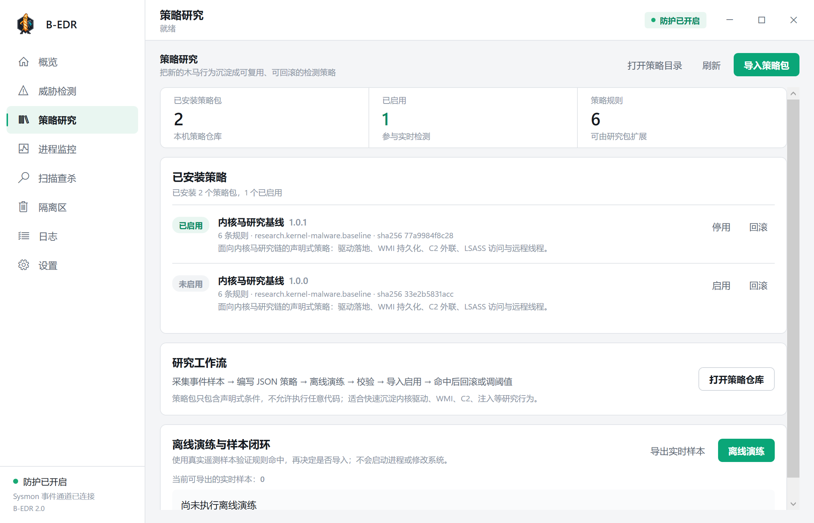

# B-EDR

B-EDR 是 `BaguetteAV` 的第二代 Windows 端点检测与响应项目，也是本毕业设计的内核马 C2 防护实验平台。项目从原来的 MFC 单进程杀毒界面演进为 WPF 控制台 + 本机 Windows 保护服务的单机杀软结构。



## 为什么单独做 B-EDR

消费级杀毒软件通常只开放防护开关、白名单和少量 HIPS 规则，无法快速表达“父进程 + 驱动签名 + 用户可写路径 + WMI + C2 端口”这类研究链。B-EDR 把检测策略做成可导入、可演练、可热加载、可回滚的 JSON 策略包，并保留真实告警、隔离和网络阻断能力。

核心特性：

- 单机双进程：`BaguetteAV.EDR.Service.exe` 持续防护，`BaguetteAV.EDR.exe` 作为 WPF 控制台。
- Sysmon 与 TCP 表遥测，覆盖进程、网络、驱动、WMI、远程线程和 LSASS 访问。
- 内置规则与导入策略共用同一检测、评分、告警和响应链路。
- 策略包版本化、SHA256 完整性复核、原子导入、热加载、停用和回滚。
- 实时遥测导出、离线演练、受限响应动作和受信任插件。
- 没有演示告警按钮，也没有伪造告警数据。

## 目录

- [B-EDR 工程说明](BaguetteAV.EDR/README.md)
- [自定义策略架构](BaguetteAV.EDR/docs/POLICY_ARCHITECTURE.md)
- [策略扩展开发指南](BaguetteAV.EDR/docs/策略扩展开发指南.md)
- [策略包示例](BaguetteAV.EDR/samples/policies/kernel-research.policy.json)
- [第一代 BaguetteAV 源码](BaguetteAV/)

## 构建

```powershell
dotnet build .\BaguetteAV.EDR\BaguetteAV.EDR.sln
dotnet test .\BaguetteAV.EDR\BaguetteAV.EDR.Tests\BaguetteAV.EDR.Tests.csproj
```

## 运行

以管理员身份安装并启动本机保护服务：

```powershell
.\BaguetteAV.EDR\BaguetteAV.EDR.Service\bin\Debug\net8.0-windows\BaguetteAV.EDR.Service.exe --install
.\BaguetteAV.EDR\BaguetteAV.EDR.App\bin\Debug\net8.0-windows\BaguetteAV.EDR.exe
```

服务负责实时检测，关闭 GUI 不会停止防护。开发调试可使用 `--local`，界面截图可使用 `--preview`。

## 防护边界

B-EDR 是用户态 EDR。它能够在驱动加载前通过策略和系统加固拦截已知风险，在加载后检测驱动落地、WMI 持久化、C2 外联和注入行为；但无法可靠恢复已经完成的内核内存篡改、LSTAR/MSR 写入或 DKOM 全链表摘除。相关边界在论文和界面中明确说明，不以“内核级全覆盖”作为结论。

## 第一代项目

第一代 BaguetteAV 是基于 ClamAV 的 MFC 杀毒软件，源码保留在 `BaguetteAV/`。第二代 B-EDR 不修改第一代主分支，以独立版本发布。
